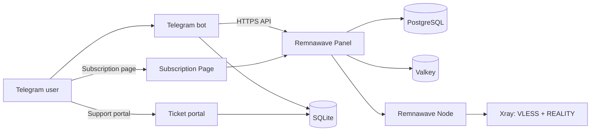

# Jopes VPN

[](https://github.com/terv1q/jopes-vpn/actions/workflows/tests.yml)
[](LICENSE)


[](https://t.me/JopesVPNBot)

Ready-to-deploy VPN service with Remnawave Panel, Telegram bot, subscription management, automated provisioning, and payment integration.

Telegram bot: [@JopesVPNBot](https://t.me/JopesVPNBot)

> [!NOTE]
> The user interface is localized in Russian. All user-facing strings live in `jopesvpn/i18n/ru.py`.

## Contents

- [Overview](#overview)
- [Features](#features)
- [Architecture](#architecture)
- [Technology stack](#technology-stack)
- [Quick start](#quick-start)
- [Configuration](#configuration)
- [Deployment](#deployment)
- [Tests](#tests)
- [Localization](#localization)
- [Security](#security)
- [Project structure](#project-structure)
- [License](#license)

## Overview

Jopes VPN combines a Telegram bot with a Remnawave Panel control plane. Remnawave remains the source of truth for users, subscriptions, devices, Nodes, and Xray configuration. The bot uses the Panel HTTPS API for provisioning and keeps its own SQLite database for preferences, orders, support tickets, notification state, referrals, and connection log state.

The repository includes a Docker Compose deployment with Panel, PostgreSQL, Valkey, Caddy, the Remnawave Subscription Page, the bot, and the ticket portal. A separate Compose file runs a Remnawave Node with Xray.

## Features

- Telegram bot with a private chat interface and a persistent menu.
- Free trial with Telegram channel membership verification and one trial per account.
- User provisioning through the Remnawave API: create, enable, disable, revoke, extend, and manage devices.
- Subscription view with status, expiry, traffic usage, and device list.
- Tariff catalog in `jopesvpn/plans.json` with unlimited and traffic packages grouped by reset period.
- Checkout with term selection and Telegram Stars invoices.
- Admin access grants and an admin section for users, plans, tickets, and connection logs.
- Support tickets in the bot plus a browser ticket portal with admin authentication.
- Background reminders, trial nudges, traffic threshold notifications, and connection alerts.
- Referral attribution with reward rules.
- Secret-free diagnostics CLI for DNS, TCP, TLS, and HTTPS checks.
- Russian localization with plural forms.
- Docker Compose deployment with pinned Remnawave, PostgreSQL, Valkey, and Caddy versions.

## Architecture



The bot never builds VPN links or edits Xray configuration. The Panel creates subscription URLs and applies them to the assigned Node. The ticket portal shares the bot SQLite database but runs as a separate container behind Caddy.

The production deployment uses VLESS + REALITY on a single exit Node. The repository also contains bridge and exit profiles under `config/remnawave/` and an isolated Panel/Node lab under `config/remnawave-lab/` for integration testing.

## Technology stack

| Component | Version |
|---|---|
| Python | 3.13 |
| aiogram | 3.26.0 |
| httpx | 0.28.1 |
| python-dotenv | 1.1.1 |
| Remnawave Panel | 3.4.5 |
| Remnawave Node | 3.4.2 |
| PostgreSQL | 18.4 |
| Valkey | 9.0.2 |
| Caddy | 2.10.2 |
| Bot state | SQLite |
| Tests | unittest |

## Quick start

Requirements:

- Python 3.13.
- A running Remnawave Panel with a scoped API token.
- A Telegram bot token from BotFather.
- At least one Telegram administrator ID.

```bash
git clone https://github.com/terv1q/jopes-vpn.git
cd jopes-vpn
python -m venv .venv
source .venv/bin/activate
pip install -r requirements.txt
cp .env.example .env
```

On Windows, activate the environment with `.venv\Scripts\activate`.

Edit `.env` and set at least `BOT_TOKEN`, `BOT_ADMIN_IDS`, `PANEL_API_URL`, and `PANEL_API_TOKEN`. Then start the bot:

```bash
python -m jopesvpn.bot
```

Check the Telegram connection without starting polling:

```bash
python -m jopesvpn.bot --check-telegram
```

The SQLite database defaults to `bot-state.sqlite3` in the working directory. Set `BOT_STATE_DB` to place it elsewhere.

## Configuration

The bot reads environment variables from `.env` or the process environment. The loader validates values and rejects placeholder credentials.

| Variable | Required | Default | Description |
|---|---|---|---|
| `BOT_TOKEN` | Yes | | Telegram bot token |
| `BOT_ADMIN_IDS` | Yes | | Comma-separated Telegram user IDs |
| `PANEL_API_URL` | Yes | | HTTPS origin of the Remnawave Panel |
| `PANEL_API_TOKEN` | Yes | | Scoped Panel API token |
| `PANEL_CA_BUNDLE` | No | | CA bundle for a private Panel certificate |
| `PANEL_INTERNAL_SQUAD_UUID` | No | | Internal Squad UUID used for created users |
| `PLANS_FILE` | No | `jopesvpn/plans.json` | Alternative tariff catalog path |
| `SUPPORT_CONTACT` | No | | Support contact shown in the bot |
| `TRIAL_CHANNEL_USERNAME` | No | `jopesvpn` | Channel required for the free trial |
| `TRIAL_DAYS` | No | `3` | Trial length in days |
| `ENABLE_TRAFFIC_PLANS` | No | `0` | Show traffic packages in the catalog |
| `ENABLE_FREE_ACCESS` | No | `0` | Enable free access reconciliation |
| `SUBSCRIPTION_PAGE_URL` | No | | Public HTTPS origin of the Subscription Page |
| `TICKET_PORTAL_URL` | No | | Public HTTPS URL ending in `/support` |
| `BOT_STATE_DB` | No | `bot-state.sqlite3` | SQLite database path |

The ticket portal uses these variables:

| Variable | Required | Default | Description |
|---|---|---|---|
| `TICKET_ADMIN_PASSWORD` | Yes | | Portal administrator password, at least 20 characters |
| `TICKET_SESSION_SECRET` | Yes | | Cookie signing secret, at least 32 characters |
| `TICKET_PORT` | No | `8080` | Internal HTTP port |
| `BOT_ADMIN_IDS` | Yes | | Telegram IDs allowed to receive admin notifications |

> [!IMPORTANT]
> Never commit `.env`, `.env.node`, or generated credentials. The repository ignores both production environment files.

## Deployment

The production layout is in `deploy/production`. It expects a Linux host with Docker Engine and the Compose plugin, DNS records for the Panel and subscription hosts, and a public IPv4 address.

```bash
cd deploy/production
cp .env.example .env
chmod 600 .env
```

Fill `.env` with random secrets and the Telegram credentials. Start the infrastructure and Panel first:

```bash
docker compose --env-file .env -f docker-compose.yml up -d remnawave-db remnawave-redis remnawave
docker compose --env-file .env -f docker-compose.yml up -d remnawave-proxy remnawave-subscription-page
```

Create the Panel administrator, add the Node, apply a config profile, create an Internal Squad, and issue a scoped API token. Then start the Node and the application containers:

```bash
docker compose --env-file .env -f docker-compose.yml -f docker-compose.node.yml --profile node up -d remnawave-node
docker compose --env-file .env -f docker-compose.yml --profile bot up -d --build bot ticket-forum
```

See [deploy/production/README.md](deploy/production/README.md) for DNS, firewall, Panel, token scope, backup, and rollback procedures.

## Tests

```bash
python -m unittest discover -s tests -v
```

The Xray integration tests run only when an `xray` binary is available on `PATH` or `XRAY_BINARY` points to one. Otherwise they are skipped. The GitHub Actions workflow runs the same suite on every push and pull request.

## Localization

The bot currently ships a Russian catalog. Translation keys are resolved through `jopesvpn/i18n/__init__.py`, and strings are stored in `jopesvpn/i18n/ru.py`.

To add a language:

1. Create a catalog module next to `ru.py`.
2. Add the locale code and display name to `SUPPORTED_LANGUAGES`.
3. Add the catalog to `_CATALOGS`.
4. Provide `one`, `few`, and `many` plural forms for keys used with `tn()`.

Missing keys fall back to the default Russian catalog.

## Security

- Use a scoped Remnawave API token. Do not use an administrator JWT.
- Keep TLS verification enabled. Use `PANEL_CA_BUNDLE` only for a deliberately configured private CA.
- Store secrets in environment files with restricted permissions. The repository ignores `.env`, `.env.node`, SQLite databases, and logs.
- The Panel remains the source of truth for VPN accounts. The bot does not store VPN credentials.
- The ticket portal records connecting IP addresses and removes them after 90 days. Back up the SQLite database only to protected storage.
- Report security issues through GitHub private security advisories instead of public issues.

## Project structure

```text
.
├── jopesvpn/                 Bot, Panel client, plans, tickets, payments, i18n
├── tests/                    unittest suite
├── deploy/production/        Docker Compose deployment, Dockerfiles, Caddyfile
├── config/remnawave/         Panel config profiles for bridge and exit nodes
├── config/remnawave-lab/     Isolated Panel and Node integration lab
├── assets/source/            Interface artwork
├── .github/workflows/        CI test workflow
├── requirements.txt
├── .env.example
└── LICENSE
```

## License

Released under the [MIT License](LICENSE).
